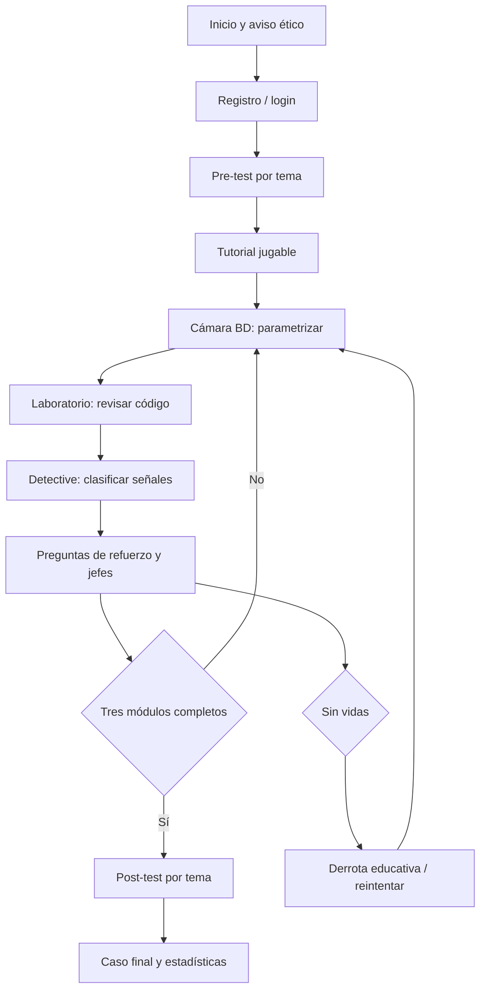

# Documento de diseño: Ciudad Red: La Gran Brecha

## 1. Concepto y narrativa

Ciudad Red es una aventura educativa web. Alex, un programador junior, recibe
la misión de restaurar una ciudad cuyos módulos fueron comprometidos por una
brecha. En lugar de atacar sistemas, Alex inspecciona ejemplos ficticios,
corrige configuraciones y documenta cada decisión. El objetivo es reparar tres
módulos, reunir evidencias y resolver el caso final.

El aviso ético aparece antes de jugar: las técnicas solo se practican en
entornos propios o autorizados. El laboratorio vulnerable opcional está
aislado y separado del juego principal.

## 2. Público y objetivos de aprendizaje

Estudiantes iniciales de ingeniería. Al finalizar, el jugador debe reconocer
inyección SQL, validación/escape, autenticación robusta e ingeniería social;
explicar por qué una mitigación funciona; y comparar su resultado en pre-test y
post-test por tema.

## 3. Mecánicas y niveles

| Nivel | Concepto | Mecánica que lo representa | Evidencia |
|---|---|---|---|
| Cámara de Bases de Datos | Inyección SQL | Elegir la consulta parametrizada y separar datos del código en retos ficticios | Escape Room BD |
| Laboratorio de Código | Validación, XSS y credenciales | Revisar fragmentos, seleccionar validación de longitud, escape y hash seguro | Escape Room programación |
| Expediente de Ingeniería Social | Phishing y análisis de evidencias | Clasificar mensajes y correlacionar DNS, registros y línea temporal | Modo Detective |

El mapa y los combates usan preguntas como refuerzo, no como sustituto de
estas mecánicas. Cada decisión muestra explicación, fuente o pista. Las vidas
crean riesgo controlado; la derrota permite reintentar y conserva el progreso.

## 4. Progresión y controles

El tutorial enseña movimiento, interacción y lectura de feedback durante el
primer minuto. WASD, flechas, clic y controles táctiles permiten desplazarse.
El jugador puede ajustar volumen y dificultad, usar comodines y consultar el
mentor. El pre-test se realiza antes de jugar y el post-test requiere tres
módulos completados.

## 5. Victoria, derrota y puntuación

La puntuación combina respuestas correctas, XP, jefes, evidencias y retos
prácticos. La victoria final se produce al completar distritos, investigación y
caso final. La derrota aparece al perder todas las vidas, explica el concepto
que debe revisarse y ofrece reintento o regreso al mapa. El guardado del
servidor mantiene XP, logros, comodines y progreso.

## 6. Flujo

## 7. Requisitos técnicos

Frontend Phaser, HTML/CSS/JavaScript y Nginx; backend FastAPI, SQLAlchemy y
MySQL; Docker Compose para ejecución reproducible. JWT con expiración protege
la API, las respuestas se validan en servidor y el juego incluye pruebas
unitarias. El código ficticio del juego no ejecuta consultas o exploits reales.

